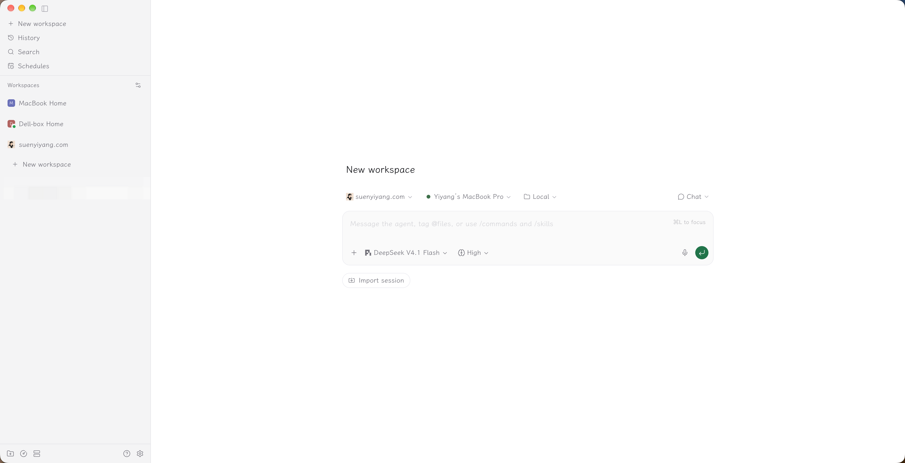
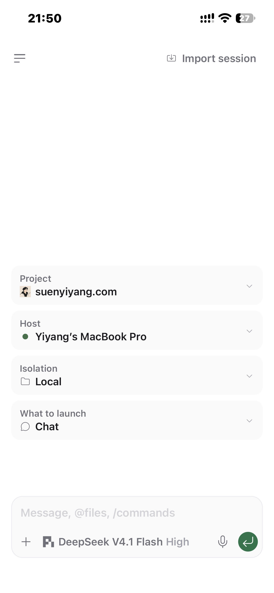
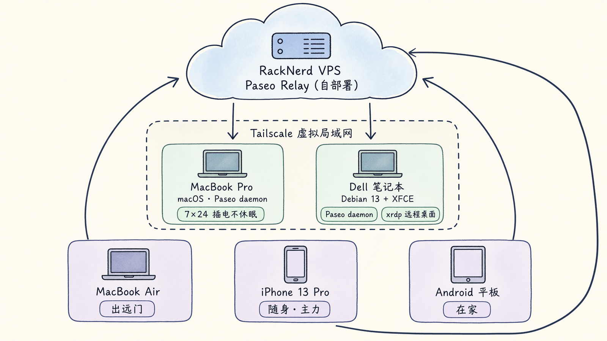

# 分享我的 Agent “搭”

前段时间我一直在尝试解决一个问题，如何能在任何我的个人设备上，随时随地接力同一个 agent session，并且不绑定某一个 agent runtime。

举个例子，我在笔记本电脑上和 agent 一块干活，突然有事要出门，出门之后用手机还想继续盯着进展，给新的 prompt；或者我在外面突然有个 idea，让 agent 干了一部分活，回家后还想用大屏设备接着和 agent 聊。

尝试过几套方案之后，最终探索出了一套我觉得还不错的方案，本文分享一下我的 agent “搭”。

> Agent “搭”取自“桌搭（Desk setup）”这个词。因为使用 agent 的方式、配套的环境配置因人而异，并且可能一直根据自己的需要在迭代，目前的配置并非终极 / 标准答案。

## 先明确需求

我的需求主要有以下几点：

1. Agent runtime 能使用不同的如 Pi coding agent、Claude Code、Codex 等，不绑定一个固定的 runtime；
2. 可以 7 x 24h 不间断运行，方便我设置一些自动化 / 定时任务；
3. 能够随时随地，使用任何手头的设备，接力同一个环境下的同一个 agent session，比如在桌子前用电脑，躺沙发上用平板，出门用手机；
4. 跨平台可用，MacOS、Linux、Windows、iOS（iPad OS）、Android 都能有相对一致的使用体验。

## 现在选择的方案

在尝试了 Herdr + Termius + Tailscale、类 Grok Bot、类 Multica 产品后，我最终选择了 [Paseo](https://paseo.sh/) 作为核心方案。

> 强力推荐 [LXGW Wenkai](https://github.com/lxgw/LxgwWenkai)，好看耐看！

Paseo 自称是一个 ADE（agentic development environment）。我理解它主要做了两件事：

1. 在本地已经安装的 agent CLI 上（比如 Pi、Claude Code、Codex CLI 等）套了一层 GUI 壳，方便脱离终端使用；
2. 实现了一个 daemon，任意一个客户端可以连到这个 daemon，同步展示最新的 agent session 状态。

另外，Paseo 提供了一个开源的中继服务（Paseo relay），可以自己部署，实现安全地在公网环境指挥局域网内的 agent 干活。

我手头有这些设备资源：

- Racknerd 云主机
- MacBook Pro
- MacBook Air
- 闲置 Dell 笔记本电脑（With Debian 13）
- 闲置 Android 平板
- iPhone 13 Pro（我的主力机）

**现在的使用方式是：**

Racknerd 云主机自部署一个 Paseo relay。避免 agent session 内容被上传到公共的 Paseo relay 服务（虽然是端到端加密的）。如果用 Tailscale 把所有的设备都拉到一个局域网内，这个 relay 服务也不是必需的，Paseo 支持客户端直连 daemon。

MacBook Pro 和闲置 Dell 笔记本电脑作为 agent 的运行环境。它俩性能比较强劲，并且配置了插电永不休眠，可以 7 x 24h 运行。同时也配置了“科学的”网络环境，方便使用 Claude Code、Codex CLI，暂时还没被 A\\ 封号。

闲置 Dell 笔记本安装了 Debian 系统 + xfce 桌面环境，并且配置了 xrdp + Tailscale，可以在 MacBook 和 iPhone 上通过 Windows App 连接到远程桌面，在 Chrome 里登录自己的一些账号，方便 agent 使用 agent-browser CLI 使用有登录态的 Profile 帮我完成一些任务。

MacBook Air、iPhone 13 Pro 作为带出门的设备。通过 Racknerd 中继服务，使用 Paseo 客户端连到家里两台设备上的 Paseo daemon。使用 GUI 指挥 agent 干活。一般 MacBook Air 只有出远门会带，手机随时随身携带，在手机上使用比较多，连接很稳定。

闲置 Android 平板上也下载了 Paseo 客户端，连接到两个 Paseo daemon，在家但又不在电脑桌前的时候使用。

**整个 setup 完美适配我自己的需求。**

- ✅ 不绑定某一个 agent runtime 或者模型；
- ✅ 稳定的 agent 运行环境，复用现有的 `.agents` 配置；
- ✅ 不同设备上 agent session 是同一份，可以随时换设备接力；
- ✅ 所有设备都有客户端可用（这个 Paseo 做的真不错）。

## 尝试过的其他方案，以及为什么放弃

在使用这套方案之前，我还尝试过几套其他的 setup，但最后都多少感觉有点不好用。本文也分享一下，如果你正在使用相同的方案，并且感觉有些不爽，可以作为决定弃用的参考。

**1. Termius + Herdr + Tailscale**

TUI 操作在手机上不是很方便。

Herdr 在移动端竖屏 UI 适配和对点击的响应做的不好。不太方便从手机直接选图片添加进 agent 的输入框。而且语音输入，特别是微信输入法，对 Termius 里 TUI 的适配不好，输入 + 润色，会有很多重复的文字输入。

Tailscale 和其他虚拟专用网络软件分流规则整合配置有点麻烦，并且 iOS 上同时只允许启动一个此类软件。

这个方案用了几周就放弃了。

**2. 类 Grok bot 产品**

之前尝试了 Grok bot，体验还不错，但只能使用 grok 的模型和订阅。而且 Grok bot 的云电脑不完全受我控制，不太放心把一些重要账号登录在那个云电脑上。

Grok bot 的云电脑和我本地主机是两套环境，有些文件、数据、上下文共享，不太好做。

试用了几天后放弃了。

**3. 类 Multica 产品**

区别于 Paseo，其他这类产品都是在用“项目管理”的思路在设计实体和实体间关系，导致体现在 UI 上，都是“看板优先”。对我来说，我甚至不知道要开一个新对话，应该给它建一个 Issue 还是应该去哪找一个对话框出来。

其次，很多这种产品，在给 agent runtime 套壳时，默认注入了自己产品相关的 tool / skill，甚至注入了文本到 system prompt 里面，有时这些注入的内容，会影响 agent 的表现。

另外，这类产品主要做 Lark 之类 IM 软件的连接器，通过 IM 消息触发，触发时又会带一大堆和 IM 软件相关的上下文到任务上下文里，客户端做的也不好用 / 对不同系统支持不全。

所以这个方案试用了挺长一段时间，最后还是放弃了。

## 后续迭代方向

首先是给 agent 更多可操作设备。

我有一个闲置的 iPhone，加上之前看到的 [iPhone-use](https://github.com/zhongerxin/iPhone-use) 项目，让 agent 可以操作我的闲置 iPhone。

如果后续闲置 Android 平板实际使用场景不多，可以通过 [Mobile MCP](https://github.com/mobile-next/mobile-mcp) 接入给 agent 使用。

其次，给 agent 更多可操作的个人账号。

有了前面两台 agent 可操作的 iOS 和 Android 设备，可以把一些社交媒体账号登录到这两个设备上。尝试把自己的注意力从社交媒体的无尽推荐流里重新拿回来。

在个人设备上登录账号让 agent 操作，也可以在一定程度上避免被一些平台的反爬机制识别和限制。
